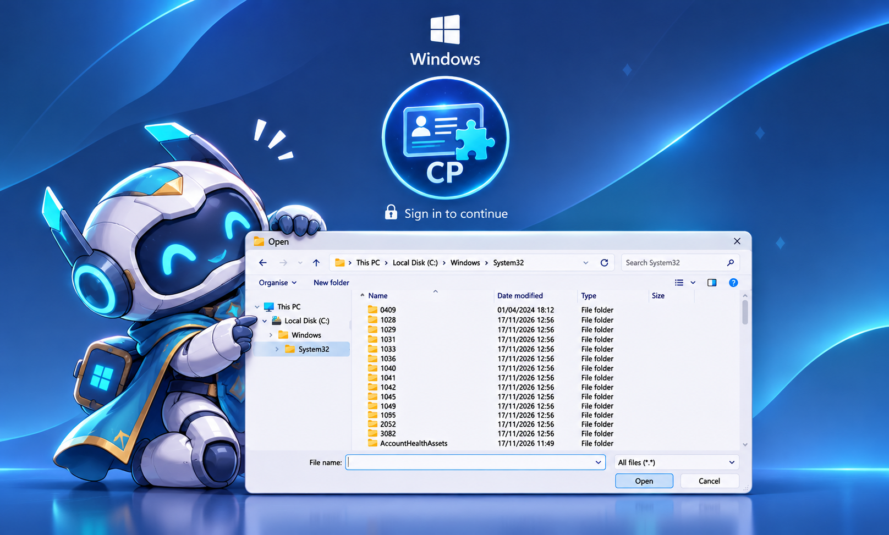

  

<pre>
Proyecto Pre-Auth                                    Noviembre de 2026
Categoría: Informativo

             Pre-Auth: proveedor de credenciales de Windows

RESUMEN

   Este documento describe el funcionamiento, las características, los
   requisitos, la instalación y el uso del proveedor de credenciales
   Pre-Auth para Windows.

                                 ÍNDICE

   <a href="#overview">1.  DESCRIPCIÓN GENERAL</a> ............................................ <a href="#overview">1</a>
   <a href="#features">2.  CARACTERÍSTICAS</a> ................................................ <a href="#features">1</a>
   <a href="#usage">3.  USO</a> ........................................................... <a href="#usage">1</a>
   <a href="#requirements">    3.1.  Requisitos</a> ............................................... <a href="#requirements">1</a>
   <a href="#building">    3.2.  Compilación</a> .............................................. <a href="#building">1</a>
   <a href="#installation">    3.3.  Instalación</a> .............................................. <a href="#installation">2</a>
   <a href="#interaction">    3.4.  Interacción</a> .............................................. <a href="#interaction">2</a>
   <a href="#updating">    3.5.  Actualización</a> ............................................ <a href="#updating">2</a>
   <a href="#uninstallation">    3.6.  Desinstalación</a> ........................................... <a href="#uninstallation">3</a>
   <a href="#preview">    3.7.  Vista previa de las operaciones</a> ........................... <a href="#preview">3</a>
   <a href="#references">4.  REFERENCIAS</a> ................................................... <a href="#references">3</a>

Proyecto Pre-Auth            Informativo                    [Página i]
</pre>

<pre>
Pre-Auth           Proveedor de credenciales de Windows     Nov. 2026

1.  DESCRIPCIÓN GENERAL

   Pre-Auth es un proveedor de credenciales de Windows que añade una
   opción visual personalizada al selector de opciones de inicio de
   sesión de cada usuario disponible. Al seleccionarla, aparece el
   enlace de comando Pre-Auth en LogonUI. Al pulsar el enlace, se valida
   el identificador del campo y se obtiene la ventana propietaria de
   LogonUI.

2.  CARACTERÍSTICAS

   o  Integración con el selector de métodos de inicio de sesión de
      Windows.

   o  Asociación con los usuarios enumerados por Windows.

   o  Compatibilidad con el inicio de sesión y el desbloqueo del equipo.

   o  Icono con fondo transparente, incrustado en la DLL.

3.  USO

3.1.  Requisitos

   Para instalar y utilizar el proveedor:

   o  Windows x64.

   o  Una sesión de PowerShell de 64 bits con privilegios de
      administrador para la instalación y la desinstalación.

   Para compilar desde Linux:

   o  GNU Make.

   o  MinGW-w64: x86_64-w64-mingw32-g++ y
      x86_64-w64-mingw32-windres.

3.2.  Compilación

   Los archivos fuente de C++, las cabeceras y la definición de recursos
   están en src/. Los iconos están en resources/. El Makefile y los
   scripts de instalación están en la raíz del proyecto.

   Desde el directorio del proyecto, ejecuta:

       make

   Se genera build/Provider.dll, con los recursos gráficos incrustados.

Proyecto Pre-Auth            Informativo                    [Página 1]
</pre>

<pre>
Pre-Auth           Proveedor de credenciales de Windows     Nov. 2026

3.3.  Instalación

   Copia los scripts y la DLL a Windows con esta estructura:

       Pre-Auth/
       |-- Install.ps1
       |-- Uninstall.ps1
       `-- build/
           `-- Provider.dll

   Desde ese directorio, abre PowerShell de 64 bits con privilegios de
   administrador y ejecuta:

       .\Install.ps1

   El instalador copia la DLL a %SystemRoot%\System32\Provider.dll
   y registra el componente como Pre-Auth. Cierra la sesión o reinicia
   Windows para que se cargue.

3.4.  Interacción

   1.  Selecciona un usuario en la pantalla de inicio de sesión.
   2.  Abre las opciones de inicio de sesión (Sign-in options).
   3.  Selecciona el icono de la calavera, identificado como Pre-Auth.
   4.  Aparecerá el enlace de comando Pre-Auth.

   El método que atiende el clic es CMinimoCredential::CommandLinkClicked,
   en src/Provider.cpp. Utiliza OnCreatingWindow para obtener la ventana
   propietaria.

3.5.  Actualización

   Desinstala la versión actual, reinicia Windows si la DLL está en uso
   y ejecuta Install.ps1 con la nueva compilación en build/Provider.dll.

Proyecto Pre-Auth            Informativo                    [Página 2]
</pre>

<pre>
Pre-Auth           Proveedor de credenciales de Windows     Nov. 2026

3.6.  Desinstalación

   Desde una sesión de PowerShell de 64 bits con privilegios de
   administrador:

       .\Uninstall.ps1

   El script elimina el registro del proveedor en LogonUI, borra
   System32\Provider.dll y elimina el registro COM del componente.
   Si la DLL sigue en uso, reinicia Windows y vuelve a ejecutar el
   desinstalador.

3.7.  Vista previa de las operaciones

   Ambos scripts admiten -WhatIf:

       .\Install.ps1 -WhatIf
       .\Uninstall.ps1 -WhatIf

4.  REFERENCIAS

   [1] Microsoft,
       <a href="https://learn.microsoft.com/en-us/windows/win32/api/credentialprovider/nn-credentialprovider-icredentialprovidercredential2">Interfaz ICredentialProviderCredential2</a>.
       Asociación de usuarios, iconos y etiquetas del proveedor.

Proyecto Pre-Auth            Informativo                    [Página 3]
</pre>
