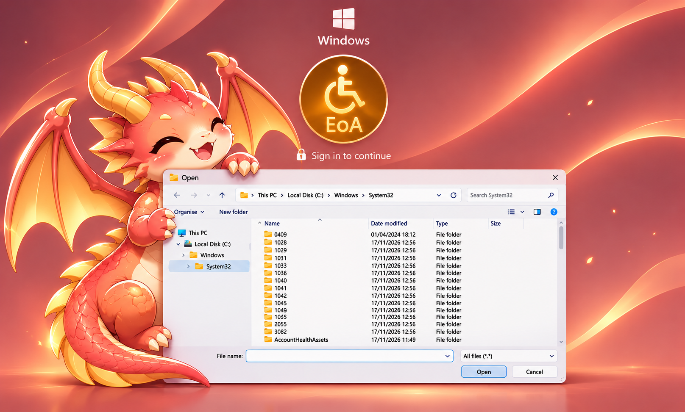

  

<pre>
Recovery System                             22 de noviembre de 2026
Categoría: Informativo

                            RECOVERY SYSTEM

RESUMEN

   Una aplicación de accesibilidad para Windows x64 que muestra el
   cuadro de diálogo Abrir al pulsar Ctrl+Alt+F9 en la pantalla de
   inicio de sesión. Windows gestiona su ejecución y la aplicación
   permanece oculta hasta que se pulsa el atajo.

                                 ÍNDICE

   <a href="#overview">1.  DESCRIPCIÓN GENERAL</a> ............................................ <a href="#overview">1</a>
   <a href="#requirements-and-build">2.  REQUISITOS Y COMPILACIÓN</a> ....................................... <a href="#requirements-and-build">1</a>
   <a href="#installation">3.  INSTALACIÓN</a> ................................................... <a href="#installation">1</a>
   <a href="#startup-settings">4.  CONFIGURACIÓN DE ACTIVACIÓN</a> .................................... <a href="#startup-settings">2</a>
   <a href="#usage">5.  USO</a> ........................................................... <a href="#usage">2</a>
   <a href="#uninstallation">6.  DESINSTALACIÓN</a> ................................................ <a href="#uninstallation">2</a>

Recovery System             Informativo                     [Página i]
</pre>

<pre>
Recovery System             Guía de uso      22 de noviembre de 2026

1.  DESCRIPCIÓN GENERAL

   Una aplicación de accesibilidad para Windows x64 que muestra el
   cuadro de diálogo Abrir al pulsar Ctrl+Alt+F9 en la pantalla de
   inicio de sesión. Windows gestiona su ejecución y la aplicación
   permanece oculta hasta que se pulsa el atajo.

2.  REQUISITOS Y COMPILACIÓN

   Para compilar se necesitan Make y MinGW-w64 en Linux, incluidos el
   compilador de C++ para Windows x64 y windres.

   Desde la raíz del proyecto EoA:

      make

   Se genera build/EoASysRec.exe, con un manifiesto y recursos de cadena
   incrustados. Copia Install.ps1, Uninstall.ps1 y la carpeta build a
   Windows, dejando los scripts junto a esa carpeta.

   Los scripts de instalación y desinstalación requieren PowerShell de
   64 bits y privilegios de administrador. Las directivas del equipo
   deben permitir su ejecución.

3.  INSTALACIÓN

   Abre PowerShell de 64 bits con privilegios de administrador y
   ejecuta lo siguiente desde la raíz del proyecto EoA:

      .\Install.ps1

   El instalador:

   o  Copia el ejecutable a %SystemRoot%\System32\EoASysRec.exe.

   o  Registra la aplicación como EoA_SysRecovery en la ubicación del
      Registro que se indica más abajo.

   o  Añade eoa_sysrecovery al valor Configuration de
      HKLM\SOFTWARE\Microsoft\Windows NT\CurrentVersion\Accessibility,
      conservando las demás entradas y evitando duplicados.

   o  Establece TerminateOnDesktopSwitch=1 y PassiveAutoStartBehavior=1
      para que Windows gestione los cambios de escritorio y el
      comportamiento de inicio automático.

   Ubicación de registro de la aplicación:

   HKLM\SOFTWARE\Microsoft\Windows NT\CurrentVersion\Accessibility\ATs

Recovery System             Informativo                     [Página 1]
</pre>

<pre>
Recovery System             Guía de uso      22 de noviembre de 2026

4.  CONFIGURACIÓN DE ACTIVACIÓN

   Puedes revisar los ajustes de activación en el Panel de control,
   en la sección de accesibilidad, dentro del centro de accesibilidad
   y sus ajustes de inicio de sesión. En una interfaz en inglés, la
   ruta es Control Panel &gt; Ease of Access &gt; Ease of Access Center &gt;
   Change sign-in settings.

   La aplicación aparece como Recovery System. Para utilizarla solo en
   la pantalla de inicio de sesión, deja marcada la casilla At sign-in
   (al iniciar sesión) y desmarcada After sign-in (después de iniciar
   sesión). El instalador configura la activación al iniciar sesión;
   no modifica los ajustes de activación del usuario en HKCU.

5.  USO

   o  Cierra la sesión o reinicia el equipo para ir a la pantalla de
      inicio de sesión. También puedes bloquear la sesión con Win+L.

   o  Pulsa Ctrl+Alt+F9 para mostrar el cuadro de diálogo Abrir.

   o  Explora las carpetas y selecciona un archivo, o pulsa Cancelar
      para cerrar el cuadro de diálogo.

   o  No ejecutes archivos mediante la opción Abrir del menú contextual
      que aparece al pulsar con el botón derecho sobre un archivo:
      podrían ejecutarse con los privilegios de la cuenta SYSTEM.

   El selector de archivos se abre en Windows\System32 y oculta las
   ubicaciones predeterminadas del panel de navegación. Seleccionar un
   archivo solo cierra el cuadro de diálogo; la aplicación no lo
   procesa ni lo ejecuta. El atajo sigue activo después de cerrar el
   cuadro de diálogo. Si ya está abierto, el atajo no abre otra
   instancia.

   La aplicación permanece oculta y Windows gestiona su ciclo de vida.
   El ejecutable espera iniciarse dentro de un objeto de trabajo (job)
   gestionado por Windows; instálalo como aplicación de accesibilidad
   para utilizarlo.

6.  DESINSTALACIÓN

   Desde PowerShell de 64 bits con privilegios de administrador, en la
   raíz del proyecto EoA:

      .\Uninstall.ps1

   El script elimina las entradas de registro y activación de la
   aplicación en HKLM y en la cuenta actual, detiene las instancias del
   ejecutable instalado y borra el binario de System32. Conserva las
   entradas de otras aplicaciones de accesibilidad. Si has activado
   Recovery System manualmente para otras cuentas, desactívalo también
   en ellas.

Recovery System             Informativo                     [Página 2]
</pre>
