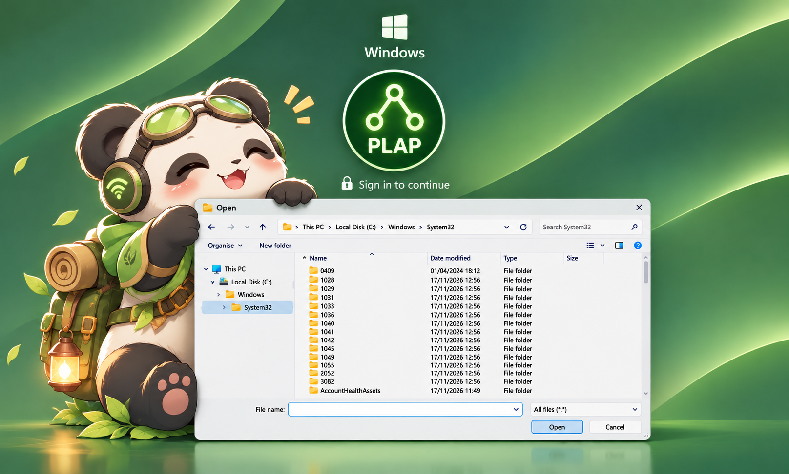

  

<pre>
PreAuth PLAP                                22 de noviembre de 2026
Categoría: Informativo

                            PREAUTH PLAP

RESUMEN

   Un proveedor PLAP para Windows x64 que muestra el cuadro de diálogo
   Abrir al seleccionar PreAuth PLAP y pulsar Connect en la pantalla de
   inicio de sesión. Windows aloja el proveedor y gestiona su ejecución.

                                 ÍNDICE

   <a href="#overview">1.  DESCRIPCIÓN GENERAL</a> ............................................ <a href="#overview">1</a>
   <a href="#requirements-and-build">2.  REQUISITOS Y COMPILACIÓN</a> ....................................... <a href="#requirements-and-build">1</a>
   <a href="#installation">3.  INSTALACIÓN</a> ................................................... <a href="#installation">1</a>
   <a href="#startup-settings">4.  CONFIGURACIÓN DE ACTIVACIÓN</a> .................................... <a href="#startup-settings">2</a>
   <a href="#usage">5.  USO</a> ........................................................... <a href="#usage">2</a>
   <a href="#uninstallation">6.  DESINSTALACIÓN</a> ................................................ <a href="#uninstallation">2</a>

PreAuth PLAP                Informativo                     [Página i]
</pre>

<pre>
PreAuth PLAP                Guía de uso      22 de noviembre de 2026

1.  DESCRIPCIÓN GENERAL

   Un proveedor PLAP para Windows x64 que muestra el cuadro de diálogo
   Abrir al seleccionar PreAuth PLAP y pulsar Connect en la pantalla de
   inicio de sesión. Windows aloja el proveedor y gestiona su ejecución.

2.  REQUISITOS Y COMPILACIÓN

   Para compilar se necesitan Make y MinGW-w64 en Linux, incluidos el
   compilador de C++ para Windows x64 y binutils.

   Desde la raíz del proyecto PLAP:

      make

   Se genera build/PreAuthPLAP.dll, con las bibliotecas de ejecución de
   MinGW enlazadas estáticamente. Copia Install.ps1, Uninstall.ps1 y la
   carpeta build a Windows, dejando los scripts junto a esa carpeta.

   Los scripts de instalación y desinstalación requieren PowerShell de
   64 bits y privilegios de administrador. Las directivas del equipo
   deben permitir su ejecución.

3.  INSTALACIÓN

   Abre PowerShell de 64 bits con privilegios de administrador y
   ejecuta lo siguiente desde la raíz del proyecto PLAP:

      .\Install.ps1

   El instalador:

   o  Copia la DLL a %SystemRoot%\System32\PreAuthPLAP.dll.

   o  Registra la clase COM como PreAuth PLAP en la ubicación del
      Registro que se indica más abajo.

   o  Establece InprocServer32 con la ruta de la DLL instalada y
      ThreadingModel con el valor Apartment.

   o  Registra PreAuth PLAP como proveedor de acceso previo al inicio
      de sesión en la vista de 64 bits del Registro.

   Ubicación de registro de la clase COM:

   HKLM\SOFTWARE\Classes\CLSID\{8B0C5DF7-3F70-4B90-9B70-61A63A3B5F25}

   Ubicación de registro del proveedor PLAP:

   HKLM\SOFTWARE\Microsoft\Windows\CurrentVersion\Authentication\PLAP Providers\{8B0C5DF7-3F70-4B90-9B70-61A63A3B5F25}

PreAuth PLAP                Informativo                     [Página 1]
</pre>

<pre>
PreAuth PLAP                Guía de uso      22 de noviembre de 2026

4.  CONFIGURACIÓN DE ACTIVACIÓN

   El proveedor se registra para la interfaz de acceso previo al inicio
   de sesión de Windows y aparece como PreAuth PLAP.

   Se accede mediante la opción de inicio de sesión de red de la
   pantalla local de inicio de sesión. El punto de entrada y su
   disponibilidad dependen de la compilación de Windows, de la
   configuración y de las directivas del equipo.

5.  USO

   o  Cierra la sesión o reinicia el equipo para ir a la pantalla de
      inicio de sesión.

   o  Abre la opción de inicio de sesión de red y selecciona
      PreAuth PLAP.

   o  Pulsa Connect (conectar) para mostrar el cuadro de diálogo Abrir.
      Windows puede representar el botón con una flecha y mostrar su
      texto en el idioma del sistema.

   o  Explora las carpetas y selecciona un archivo, o pulsa Cancelar
      para cerrar el cuadro de diálogo.

   o  Utiliza los controles de Windows para volver atrás o cancelar
      cuando necesites regresar al inicio de sesión habitual.

   El selector de archivos se abre en Windows\System32 y oculta las
   ubicaciones ancladas del panel de navegación. Al seleccionar un
   archivo, se cierra el cuadro de diálogo y finaliza la interacción
   con PLAP.

   Windows gestiona el ciclo de vida del proveedor y proporciona la
   ventana propietaria del cuadro de diálogo.

6.  DESINSTALACIÓN

   Desde PowerShell de 64 bits con privilegios de administrador, en la
   raíz del proyecto PLAP:

      .\Uninstall.ps1

   El script elimina las entradas de registro PLAP y COM del proveedor
   en HKLM y borra PreAuthPLAP.dll de System32.

PreAuth PLAP                Informativo                     [Página 2]
</pre>
